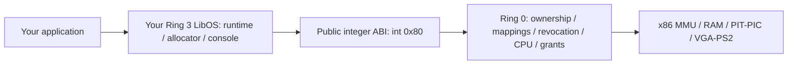

# Liberums — Educational Exokernel

[简体中文](README.zh-CN.md) · [Architecture course](docs/architecture-guide/README.md) · [Build your own LibOS](docs/libos-development/README.md)

Liberums is a **C11 / i686 research and teaching exokernel**, with a small amount
of x86 assembly. Its principle is **Kernel protects resources; LibOS manages resources**.
The kernel validates ownership, mappings, CPU transitions and device access;
independent Ring 3 libraries choose allocation strategies and application APIs.
It is not a production OS, a Linux substitute, or a port of MIT Xok.

Phase 10 establishes the **v1.0.0 Educational Release** baseline: a public Kernel
ABI SDK, independent examples, runnable lessons and recorded validation.
“Stable” refers to this teaching scope and tested interface, not universal hardware
compatibility or a production security guarantee. Major feature development ends
here; maintenance continues. A Git tag and an actual GitHub Release are separate:
see [delivery status](docs/release-validation.md).

## What is implemented

- Multiboot v1, protected mode, COM1 diagnostics, paging and protected physical pages.
- Independent Ring 3 domains, private CR3/user/kernel stacks, Capability ownership,
  Epoch/Generation checks, secure bindings and bounded resource transfer.
- ELF32 loading, up to four live domains / eight boot modules, IRQ0 round-robin,
  cooperative compatibility and explicit preemptive execution profiles.
- Visible ordinary-RAM revocation: POLL/INFO/ACK, deadlines, forced unmapping and zeroing.
- Exclusively granted VGA text MMIO and a bounded PS/2 IRQ1 queue; user-space console policy.
- Kernel ABI 1.2: 26 scalar calls, historical ABI 1.1 compatibility and optional devices.



Different LibOS implementations may use different application APIs. Aelthuvor is
an optional external compatibility test, **not a build or tutorial dependency**.

## First build — Linux / WSL2

GNU Make, Python 3, GCC supporting freestanding `-m32`, GNU Binutils with elf_i386,
QEMU i386 and GDB with Python are required. Host GCC/ASan/UBSan run the native tests.
For Ubuntu/WSL2, a typical installation is:

```sh
sudo apt update
sudo apt install build-essential gcc-multilib binutils make python3 git qemu-system-x86 gdb

git clone https://github.com/Evan-Windproof/Liberums.git
cd Liberums
make -j2
make run
```

The kernel uses TCG, one CPU and 32 MiB; KVM/root is not required. `make run` stays
headless and preserves COM1 diagnostics. The guest halts after finite tests;
stop the QEMU process when finished. Missing tools produce explicit diagnostics.
Source archives also build: Git is not needed to export their public headers.
`CROSS_COMPILE=i686-elf-` can select a suitable cross toolchain.

## Run and debug

```sh
make debug                       # paused QEMU, GDB TCP port 1234
# Another terminal:
gdb build/liberums.elf
# (gdb) target remote :1234
# (gdb) hbreak kernel_main
# (gdb) continue
```

[Debugging guide](docs/debugging-guide.md) explains user symbols, CR3/PTE/TSS and faults.
Original `run-console`, `run-external-console`, `run-multi`, `test-phase8` and
`test-phase9` targets remain available. Local graphical examples need a QEMU
build with GTK plus a desktop/WSLg. A none-backend screenshot is not a visible-window test.

## Public SDK and independent examples

```sh
make sdk libos-examples
make run-libos
make run-libos LIBOS_ELF=build/examples/memory-policy/libos.elf
make run-teaching-console QEMU_DISPLAY=gtk    # local graphics only
make test-libos-examples                     # headless QEMU/GDB + real simulated PS/2
```

The exported `build/kernel-sdk/include/abi/` comes directly from the six canonical
[public headers](include/abi/), with a source/hash manifest. There is no second ABI
constant table or Ael application API in this SDK. [ABI guide](docs/public-abi.md).

[Examples](examples/libos/README.md): minimal entry/runtime; a bitmap object pool;
a VGA/keyboard console. `common/` is ordinary user code included with the examples.
The step-by-step courses are in Chinese with runnable C/assembly and shell commands.

Create a project in an **empty directory**, with no kernel source dependency:

```sh
python3 scripts/new_libos.py --sdk build/kernel-sdk --output ../my-libos
make -C ../my-libos
make run-libos LIBOS_ELF=../my-libos/build/libos.elf
```

[Ten lessons](docs/libos-development/README.md) lead from Hello to your own runtime,
resource strategy, revocation and multiple LibOS instances. [Learning path](docs/learning-path.md).

## Validation and compatibility

```sh
make test                         # Phase 1–9 regression, native and QEMU/GDB
make test-libos-examples           # outside consumers and teaching programs
make test-libos-compat PHASE10_AEL_BUILD=/path/to/Aelthuvor/build  # optional
make test-phase9-e2e PHASE9_AEL_BUILD=/path/to/Aelthuvor/build     # optional
```

Validation checks actual CPL/CR3/TSS/PTEs, owner identity, generations, zeroing,
IRQ delivery, faults and reclamation. The 128-reuse stress and external RAM
revocation coverage remain. Native simulation, QEMU/GDB, renderer captures and
manual GTK/keyboard interaction are reported separately. [Results](docs/release-validation.md).

## Scope and maintenance

Single CPU; four live domains; sixteen RAM resources globally, four per domain;
four bindings per resource; eight revocation events. No general Spawn, fork/exec,
POSIX, general IPC, filesystem, networking, SMP, dynamic linker or GUI desktop.
Devices are exclusive. Cooperative mode cannot force CPU progress. Ordinary i686
paging lacks NX/full hardware W^X. Forced revocation cannot transparently restore
old pointers. Transfer 22 routes to the currently active ID, not a cached Epoch.
[Complete limits](docs/known-limitations.md).

[Maintainer guide](docs/maintainer-guide.md) covers fixes, ABI policy, compatibility
reports and patch releases. [Release notes](RELEASE-NOTES.md), [changelog](CHANGELOG.md),
[historical index](docs/history.md). Existing Phase 1–9 evidence stays in place.

License: **GPL-3.0-or-later**; see [LICENSE](LICENSE) and source SPDX notices.
The console teaching code adapts Liberums's own user-space core with provenance;
no Aelthuvor framework is embedded. Thanks to the GNU/QEMU/GDB communities.
Academic background: Engler, Kaashoek and O'Toole, [Exokernel, SOSP 1995](https://pdos.csail.mit.edu/6.828/2008/readings/engler95exokernel.pdf).
The historical ideas are not claims that Liberums implements all Xok/ExOS features.
