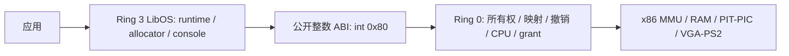

# Liberums — 教学型 Exokernel

[English](README.md) · [内核架构课程](docs/architecture-guide/README.md) · [开发自己的 LibOS](docs/libos-development/README.md)

Liberums 是用 **C11、i686 与少量 x86 汇编**编写的教学与研究型 Exokernel。
核心原则是 **Kernel protects resources; LibOS manages resources**：
内核验证所有权、映射、CPU 转换与设备访问，独立 Ring 3 库自行选择分配策略和应用 API。
它不是生产级操作系统、Linux 替代品或 MIT Xok 移植。

Phase 10 建立 **v1.0.0 教学发布基线**：公开 Kernel ABI SDK、独立示例、可运行课程与验证记录。
“稳定”表示教学范围和已测试接口形成基线，不代表完整硬件兼容或生产级安全保证。
主要功能开发在此停止，后续继续维护。Git Tag 与实际 GitHub Release 是不同事项，
见 [交付状态](docs/release-validation.md)。

## 已实现

- Multiboot v1、保护模式、COM1 诊断、分页与受保护物理页。
- 独立 Ring 3 域、私有 CR3/用户栈/内核栈、Capability、Epoch/Generation、安全绑定和有界转移。
- ELF32、最多四个活跃域/八个 boot 模块、IRQ0 轮转、合作兼容及显式抢占 profile。
- 普通 RAM 可见撤销：POLL/INFO/ACK、deadline、强制解除映射与清零。
- 独占授权的 VGA 文本 MMIO 和有界 PS/2 IRQ1 队列，用户态 Console 策略。
- Kernel ABI 1.2：26 个标量调用、历史 ABI 1.1 兼容与可选设备扩展。



不同 LibOS 可有不同 Application API。Aelthuvor 仅是可选外部兼容性测试对象，
**构建内核、学习课程或创建自己的 LibOS 都不依赖它**。

## 首次构建：Linux / WSL2

需要 GNU Make、Python3、支持 freestanding `-m32` 的 GCC、支持 elf_i386 的 GNU Binutils、
QEMU i386 和带 Python 的 GDB；宿主 GCC/ASan/UBSan 用于 native 测试。
Ubuntu/WSL2 常见安装方法：

```sh
sudo apt update
sudo apt install build-essential gcc-multilib binutils make python3 git qemu-system-x86 gdb

git clone https://github.com/Evan-Windproof/Liberums.git
cd Liberums
make -j2
make run
```

默认使用 TCG、单 CPU、32 MiB，不需要 KVM/root。`make run` 保持无窗口及原 COM1 诊断。
有限实验完成后 guest 停机等待，结束时停止 QEMU 进程。缺失工具会有明确提示。
源码归档也可构建/导出 SDK，不要求存在 Git 元数据；可用 `CROSS_COMPILE=i686-elf-` 选择交叉工具链。

## 启动与调试

```sh
make debug                       # 暂停的 QEMU，GDB TCP 1234
# 另一终端：
gdb build/liberums.elf
# (gdb) target remote :1234
# (gdb) hbreak kernel_main
# (gdb) continue
```

[调试指南](docs/debugging-guide.md) 解释用户符号、CR3/PTE/TSS 和故障。
原 `run-console`、`run-external-console`、`run-multi`、`test-phase8`、`test-phase9` 保留。
本地窗口需要支持 GTK 的 QEMU 和桌面/WSLg；none 后端截图不能冒充窗口可见性。

## 公开 SDK 与独立示例

```sh
make sdk libos-examples
make run-libos
make run-libos LIBOS_ELF=build/examples/memory-policy/libos.elf
make run-teaching-console QEMU_DISPLAY=gtk    # 仅本地图形环境
make test-libos-examples                     # 无窗口 QEMU/GDB + 实际模拟 PS/2
```

`build/kernel-sdk/include/abi/` 直接来自六个[公开头](include/abi/)，附来源与哈希 manifest。
不维护第二套 ABI 常量，也不把 Ael 应用 API 放入 Kernel SDK。[ABI 指南](docs/public-abi.md)。

[示例](examples/libos/README.md) 包含最小入口/runtime、bitmap 对象池和 VGA/键盘 Console。
`common/` 是随示例分发的普通用户代码。课程为中文，附可执行的 C、汇编和命令。

在**空目录**创建项目，不读取内核私有源码：

```sh
python3 scripts/new_libos.py --sdk build/kernel-sdk --output ../my-libos
make -C ../my-libos
make run-libos LIBOS_ELF=../my-libos/build/libos.elf
```

[十课教程](docs/libos-development/README.md) 从 Hello 逐步到自己的 runtime、资源策略、撤销与多 LibOS。
[分级学习路线](docs/learning-path.md)。

## 验证与兼容性

```sh
make test                         # Phase 1～9，native 与 QEMU/GDB
make test-libos-examples           # 仓库外消费者与教学程序
make test-libos-compat PHASE10_AEL_BUILD=/path/to/Aelthuvor/build  # 可选
make test-phase9-e2e PHASE9_AEL_BUILD=/path/to/Aelthuvor/build     # 可选
```

验证实际 CPL/CR3/TSS/PTE、owner 身份、代数、清零、中断、故障和回收。
128 轮复用及外部 RAM 撤销覆盖保留。宿主模拟、QEMU/GDB、renderer 截图、
人工 GTK/实体键盘验证分开报告。[实际结果](docs/release-validation.md)。

## 范围与维护

单 CPU，四个活跃域；全局 16 项普通 RAM、每域四项、每资源四绑定、八项撤销事件。
没有通用 Spawn、fork/exec、POSIX、一般 IPC、文件系统、网络、SMP、动态链接或 GUI 桌面。
设备独占，合作模式不保证强制 CPU 进度；普通 i686 无 NX/完整硬件 W^X。
强制撤销不透明恢复旧指针，调用 22 按当前活跃 ID 而非缓存 Epoch 路由。
[完整限制](docs/known-limitations.md)。

[维护手册](docs/maintainer-guide.md) 说明修复、ABI 政策、第三方兼容报告和补丁发布。
另见 [Release Notes](RELEASE-NOTES.md)、[Changelog](CHANGELOG.md)、[历史索引](docs/history.md)。
Phase 1～9 的原始证据保留，不移动或覆盖。

许可证 **GPL-3.0-or-later**，见 [LICENSE](LICENSE) 和源码 SPDX。
Console 教学代码来自本仓库既有用户态 core 并记录来源，没有嵌入 Aelthuvor Framework。
感谢 GNU、QEMU、GDB 社区。学术背景：Engler、Kaashoek、O'Toole 的
[Exokernel, SOSP 1995](https://pdos.csail.mit.edu/6.828/2008/readings/engler95exokernel.pdf)。
引用思想不表示实现了 Xok/ExOS 的全部能力。
