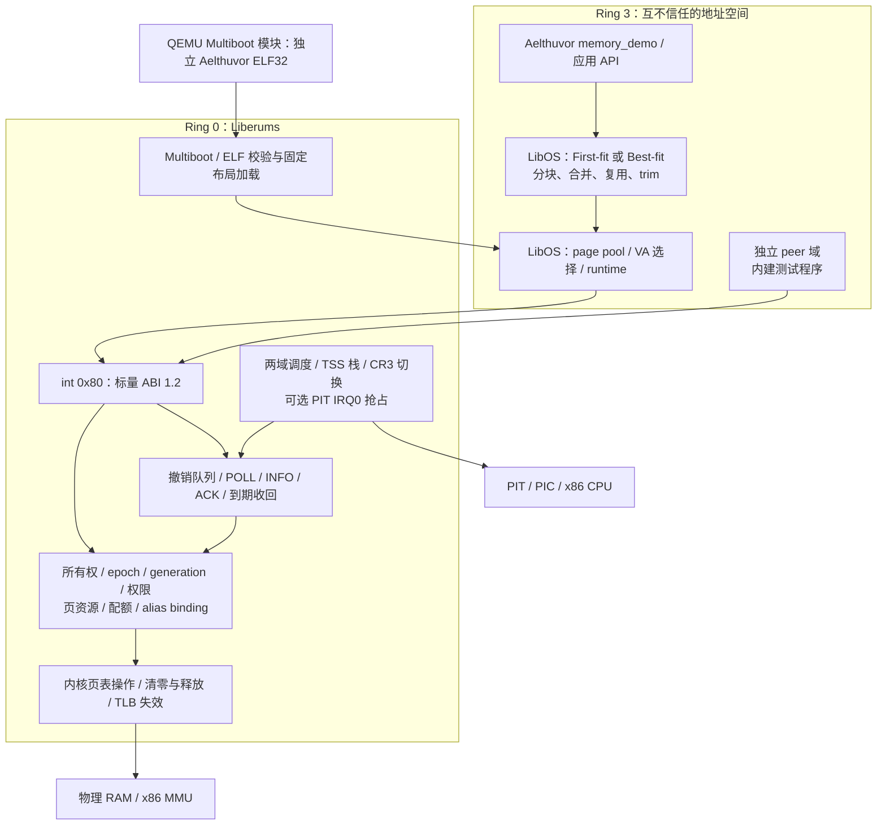

# Liberums Exokernel 架构审查

本次审查针对 Liberums `85a493466afe2038ca22a9870f6f9ce37dd7f3a8` 与 Aelthuvor `b10d337d254b18e98204990203a77a215c82c568`。开始时两个远程 `main`/HEAD 均与这两个基准一致，没有覆盖新提交。执行窗口为 2026-11-16（Asia/Taipei；日志清单使用 UTC）。本提交只增加审查文档、文本证据和非侵入式审计脚本，没有实现下一 Phase。

## 结论与判断标准

**Liberums 已实现内存资源范围内有实际硬件证据的 Exokernel 原型，Protection / Management 分离成立；尚不是完整或生产级 Exokernel。** Aelthuvor 的分块策略、复用和运行时在独立 ELF 的 Ring 3 内运行，内核没有 First-fit / Best-fit 或 Aelthuvor 专属分支。与此同时，固定地址布局、两个域、终止式异常处理、有限资源窗口和仅诊断路径触发的撤销，明显限制了用户态资源管理的自由度。

参考 Engler、Kaashoek、O'Toole 的 [SOSP 1995 原论文](https://pdos.csail.mit.edu/6.828/2008/readings/engler95exokernel.pdf)，尤其资源暴露、绑定与撤销的讨论：判断依据是保护与管理的分离，以及绑定、可见撤销和强制收回。内核仍须在竞争者之间仲裁。因此，所有权表、配额、必要驱动和最低限度调度本身不构成架构违规。本文没有将论文的性能或完整能力归给本项目。

证据等级：**[实测]** 为本次构建/QEMU/GDB/宿主测试观察；**[源码]** 为已核对的实现；**[推断]** 为由实现导出的条件性结论；**[未验证]** 不计入通过项。测试状态及可重现命令见 [集成报告](aelthuvor-integration-audit.md)，原始文本见 [证据目录](audit-evidence/README.md)。本次没有发现并实测复现跨域越权成功；这不等于证明所有安全性质。

## 当前实际架构

图中的 Aelthuvor 路径仅在默认合作 profile 下验证成功。`external preempt` 会拒绝其原始 COOPERATIVE 要求。图中撤销机制已由 Phase 6 测试程序验证，不能理解为 Aelthuvor 已接入该协议。

## 模块职责及分离程度

以下位置均以被审查基准的行号为准；Aelthuvor 路径属于其独立仓库。

| 模块 / 位置 | 实际职责 | 评价 |
|---|---|---|
| `kernel/boot_info.c`、`memory_map.c`；`physical_pages.c:24,78,93,102` | 解析引导信息、保留区域、物理页状态、自动或指定 PFN 分配 | 保护与仲裁；扫描空闲页不等于应用堆分配策略 |
| `kernel/capability.c:3,17`；`resource.c:17,51` | index/generation、owner/epoch、rights、配额、清零后发布所有权 | 内核必须维护的 authority 与记账 |
| `resource.c:101,138,168,180`；`arch/x86/paging.c:188,214` | 校验后安装/移除 PTE、记录所有 alias、回收页和动态页表 | 内存 Secure Binding；访问阶段由 MMU 执行保护 |
| `domain.c:35,62,214,228`；`gdt.c:17,42` | 根据可信当前域/CR3/TSS 栈确定调用者，保存恢复现场 | 隔离机制；不是用户传入 ID 自行声明身份 |
| `scheduler.c:10`、`timer.c:26`、`irq.S:6` | 两域轮转、可选 IRQ 抢占、退出清理 | 最低仲裁合理，但 CPU 分配接口很有限 |
| `revoke.c:25,67,83,121,135` | 绑定到 owner/epoch/handle/request 的撤销，ACK 与到期收回 | 页资源撤销机制成立；来源和恢复协议仍有限 |
| `elf_loader.c:13,32,73`、`user_space.c:19` | ELF32、ABI note、段权限与固定地址校验，加载/失败回滚 | 引导设施合理；固定 VM 布局是自由度限制 |
| Aelthuvor `src/page.c:26,54,96,111` | 用户选择权利及 VA，claim/map/release，失败补偿 | 管理策略在 LibOS；内核只裁决请求是否合法 |
| Aelthuvor `src/memory.c:14,34,96,136` | 16 字节对齐、First/Best-fit、拆块/合并/复用、trim | 真正独立的用户态内存管理 |
| Aelthuvor `src/runtime.c:19`、`compat.c:3`、`include/aelthuvor/*.h` | 入口、ABI/容量探测、应用 API、退出 | 与应用静态链接的 LibOS，不是内核服务 |

**[实测]** 两仓库都能在没有对方源码的独立导出目录构建。Aelthuvor First/Best 两个 ELF 都在 `CS=0x1b`、私有 CR3 下完成内存行为测试。策略不同而内核及 ABI 完全相同，是本项目目前最直接的架构证据。

## 已实现的核心机制

1. **物理保护和 Ownership。** `resource_claim` 只接受空闲、可分配物理页；保留/内核区域不可由用户指定抢占。发布前清零，归还前撤销全部 alias 并清零。内核拥有页表和可信资源表。[源码＋Phase 2/4 实测]
2. **Capability validation。** 句柄为 index + 完整 32 位 generation，另核对调用域 id、epoch 和所需权限。generation 到上限永久退役槽位；域 epoch 到上限停止创建，不绕回。它不是密码学令牌，也无需靠 index 保密来隔离域。[源码＋宿主边界/Phase 4 实测]
3. **Secure Bindings。** `resource_map` 检查 MAP 及 requested R/W 权限、VA、alias 容量；成功后记录 PTE 和引用。之后普通访问不进入内核。`release/transfer/revoke` 遍历全部 alias，再允许物理页复用。[源码＋Phase 4/6 实测]
4. **域隔离与受控硬件访问。** U/S 页权限、只读代码、CR0.WP、唯一用户 syscall gate、TSS 禁止端口 I/O；用户 CLI、内核/页表/物理别名访问被硬件拒绝。FPU 目前通过 TS/#NM 拒绝使用，不是虚拟化。[源码＋Phase 3 实测]
5. **CPU 保护。** 可选抢占 profile 中，真实 IRQ0 可以打断不 yield 的循环并让 peer 运行；保存 GP、段寄存器、用户 ESP/SS、标志，单独恢复可信调度栈。默认合作模式不提供这一可用性保证。[Phase 6 实测]
6. **Visible Revocation 与强制收回。** 事件含 handle/index/generation、域 epoch、独立不回绕 request ID、reason/deadline；POLL/INFO 非消费式；ACK 或到期均由内核撤销映射、清零、释放。pending 时 map/transfer 返回 EBUSY，release/exit 取消请求。[源码＋宿主协议/Phase 6 实测]

这六项的“已实现”限于当前内存与两域模型。尤其不能从第 6 项推导出 Aelthuvor 已能安全保存、迁移或恢复被撤销的数据。

## LibOS 自主性与跨仓库耦合

| 问题 | 核对结果及依据 |
|---|---|
| Liberums 构建是否必须有 Aelthuvor？ | 否。`Makefile:18` 起列出的内核对象、`user_images.S` 内建 fixtures 均在本仓库；默认 all/test 不读 Aelthuvor。仅 `Makefile:124` 的显式 `test-libos` 入口调用另一个仓库。独立目录构建已通过。 |
| Aelthuvor 是否包含内核私有头？ | 未发现。编译 include 路径为其自身 include、vendored `sdk/include`、tests；`src/syscall.c` 经公共 ABI 执行 `int 0x80`。`sdk/manifest.json` 固定公共 SDK 来源和 SHA256。 |
| 内核是否调用 LibOS 内部函数？ | 未发现。kernel/arch 中没有 ael_* 调用或 Aelthuvor 符号链接；外部入口取自已验证 ELF。GDB 添加外部符号仅用于测试，不参与内核链接。 |
| 是否可更换 LibOS？ | 在同一 ELF32/地址窗口/ABI/profile 约束内可以；Phase 5 独立 minimal/normal ELF 和 Aelthuvor 均实际运行。不是任意 ELF、POSIX 程序或任意 VM 实现均可运行。 |
| 能否独立换分配算法？ | 可以。First/Best 选择位于 Aelthuvor `runtime.c:24` 和 `memory.c:34`，无对应 syscall 或内核分支；两个构建实测通过。 |
| 是否有隐藏构建耦合？ | 核心构建没有；集成测试有显式耦合：Aelthuvor `tests/integration.py:20` 要求当前公共头逐字节相同，并调用 Liberums 的私有测试辅助脚本；`tests/libos.py:18` 还将运行 ABI 写死为 1.1。这些是测试维护缺陷，详见集成报告。 |

内核中的 `user/resource_test.c` 使用私有测试头属于本仓库 fixtures，不能据此误判独立 Aelthuvor 依赖内核私有实现。内核的实验钩子也不能当作生产回收策略。

## 未完成机制、简化与潜在偏离

| 类别 | 当前边界 | 后续风险 |
|---|---|---|
| VM 自主性有限 | 固定 ELF 镜像/栈；资源 VA 仅 `0x09000000..0x09010000`（16 页）；域配额 4，alias 上限 4 | 地址选择是 LibOS 策略，但不是任意 VA 管理；无用户 pager、缺页上调、换页或通用映射布局 |
| CPU 暴露有限 | 两个静态域、一个 tick 一片轮转；无用户 CPU capability、预约/配额协商或用户调度器接口 | 可保护 peer 进度，但不能声称已实现灵活的用户态 CPU 管理 |
| 撤销尚未用于一般压力 | `revoke_request` 的当前实际调用者为 `tests/phase6_runtime.c:56`；普通 claim 失败返回错误 | 机制存在不等于真实内存压力闭环；不存在已验证的 LibOS 选择牺牲页策略 |
| 强制失去资源的恢复不足 | `revoke.c:104` 完成时删除 active 事件，无完成 tombstone/用户异常上调 | 超时后晚轮询不能直接得知哪一页被收回；原始 Aelthuvor 不处理事件 |
| 通用硬件资源尚缺 | 主要暴露页；串口仅受限字符日志，PIT/PIC 由内核驱动 | 没有磁盘/网络/DMA 的安全暴露及应用级管理证据；也没有安全下载代码/packet filter |
| 生命周期和共享简化 | 单外部模块、两个域、单槽 inbox；transfer 撤旧 alias 并清零数据 | transfer 是清零的所有权转移，不是保留数据的共享内存/通用 IPC |
| 测试设施进入特权二进制 | `Makefile` 总是链接 selftest、pressure、phase6_runtime，scheduler 无条件调用测试钩子 | 当前入口显式由 boot options 控制、没有 LibOS 专属策略；生产化应拆分测试配置，避免测试布局演变成固定管理模型 |

这些限制大多属于教学原型的范围约束。若未来将固定布局、应用堆算法、pager 策略或特定 LibOS 元数据格式写进内核，则会实质削弱 Protection / Management 分离；本次没有发现这样的堆策略分支。

## 安全与工程质量：证据、风险和建议

| 编号 / 风险 | 触发条件与证据 | 建议及验证边界 |
|---|---|---|
| F1 中：集成测试失效 | ABI minor 从 1.1 增到 1.2；原集成入口因 `syscall.h` drift 退出 2；原 GDB oracle 在已到达 Aelthuvor stage 2 后因 `==0x10001` 退出 1 | 分离 SDK 完整性/来源固定和运行 ABI 兼容判定。本次保留失败，用独立审计脚本验证，不修改 Aelthuvor 或删除哈希。 |
| F2 高（条件性可用性限制）：默认合作模式可被恶意循环占住 | `domain.c:62` 清 IF，scheduler 只能在 yield/exit/fault 后返回。[源码推断，未将合作模式无限循环另做运行实验] | 对不可信、要求 CPU 进度隔离的程序使用可兼容抢占 profile；原 Aelthuvor 仍要求合作模式，不能擅改 note 绕过。此项不意味着页隔离失效。 |
| F3 高（条件性 LibOS 正确性）：撤销后仍持有旧用户元数据 | 强制移除动态页后，Aelthuvor BSS 中 `owned/mapped/used/address` 不会自动更新；`memory.c:48` 可直接复用记录，`page.c:103` 仅成功才清 metadata。[源码推断；原始 ELF 被 profile gate 拒绝，没有声称本次实测 Aelthuvor 撤销损坏] | Phase 2 设计 live block、稳定指针、迁移/拒绝/终止语义；处理 ESTALE 与生命周期；将协议元数据放在可保证存活区域。单纯添加 ACK 不足。 |
| F4 中：强制完成缺少持久可见记录 | `revoke.c:104` 先清 active，再 reclaim；超时后 POLL/INFO 不能看到该事件；Phase 6 证明保护正确，但未证明 LibOS 可恢复 | 明确 abort 后状态发现协议、完成记录或受控终止；这是通用协议问题，不能让内核理解 Aelthuvor 的 arena。 |
| F5 中（扩展条件）：串行假设是安全前提 | `resource.c:248`、`revoke.c:61` 依赖单 CPU/IF=0；`user_context.S:6` 只有一个 scheduler_esp，TLB 仅本 CPU | 引入 SMP、内核抢占或嵌套调度前须增加同步、每 CPU 调度状态和 shootdown；本次没有验证这些模式。 |
| F6 低至中（生产化）：异常和栈保障有限 | 每域 8192 字节静态 kernel_stack；没有 guard page/独立 double-fault task stack；NMI/DF/MCE 走 fatal panic（`idt.c:73`） | 当前普通用户异常已实测隔离；不能扩大到双重故障、NMI 嵌套、栈耗尽或硬件故障恢复。后续按目标增加 guard 和故障栈。 |
| F7 中（能力声明边界）：无硬件 NX | i686 非 PAE 页表只能 R/W、U/S；`paging.c:154` 已注明非 NX；ELF 拒 W+X 仅为段声明校验 | 不得宣称硬件 W^X：可写数据/堆/栈仍可能执行。未来选择支持 NX 的分页模式时再验证。 |
| F8 低至中：期限不是严格墙钟时限 | `timer.c:26` 计数已交付 tick，IF=0 时 IRQ 延迟，`scheduler.c:30` 在片段返回后 expire；宿主边界测试证明不回绕 | 明确 delivered-tick 语义。若要求实时期限，需额外时钟与延迟界测试；本次不作实时保证。 |

### 已核对的关键安全路径

- **Ring 0/3、IRQ、异常栈及调度现场：[实测＋源码]** `idt.c:37` 的 syscall gate 为 DPL3，其余异常/IRQ 为 DPL0 interrupt gate。`irq.S` 先保存所有 GP 和段寄存器，再装内核段/清 DF；Ring 0 返回不读取不存在的 outer ESP/SS。IRQ0 先 EOI 再离开栈。`domain_preempt` 验证段，`domain_run_slice` 在可信栈恢复 kernel CR3，再开始 reclaim。Phase 6 实测用户寄存器、段/CF/DF、恢复现场，以及一次显式 `sti; hlt; cli` 的内核来源 IRQ；没有测试任意内核临界区被强行打开 IF 或 NMI 嵌套。
- **CR3、页表和 TLB：[实测＋源码]** kernel identity aliases 全为 supervisor；动态 unbind 对当前空间 invlpg，移除末页表时 reload CR3 后再释放 table；非活动空间下次入域 reload CR3。没有 PGE/PCID/SMP 假设。多 alias 的强制撤销、旧 owner stale write #PF、新 owner 同 PFN 重用及清零均由 Phase 6 断言检查。
- **句柄/撤销身份和交错：[宿主＋QEMU]** pending 禁止 map/transfer；release/exit 取消请求；ACK 必须同时匹配 request、owner epoch 和完整 handle；旧 ACK 不影响新 owner。宿主协议测试覆盖事件队列满、deadline/ID/generation 上界、epoch、终止与 expire 顺序及多次复用；QEMU 验证具体执行顺序。它们不是所有可能状态序列的穷尽证明。
- **失败回滚与清零：[实测＋源码]** ELF 校验先于用户空间创建，失败 plan 清空；实际 OOM 路径在分配 5 页后回滚，逐页检查 zero/free；显式释放、exit-live、fault、readonly fault 和重复生命周期均恢复 free count。`physical_page_free` 本身只改状态，清零责任在调用者，未来增加调用点仍须审查。
- **直接攻击真实 LibOS：[本次新增实测]** 非侵入式审计仅把 peer 自己的用户数据设为现有 read/write denial 测试输入，未修改任何指令、内核资源表或 Aelthuvor 源码。peer 对 Aelthuvor 仍存活的 `0x09000000` 实际读/写分别 #PF error 4/6；First/Best 均继续退出 0，资源清零归还。详见集成报告及四份 hostile-peer GDB 记录。

## 不应夸大的能力

本次证据支持当前单 CPU、QEMU qemu32、32 MiB、固定 ABI/profile 与测试矩阵下的机制正确性，不支持生产安全认证、形式化证明、恶意 DMA/IOMMU、侧信道防护、SMP、任意 ELF、用户级缺页恢复、POSIX 兼容、实时调度、任意 LibOS 并发负载或 Aelthuvor 已支持撤销。两个不同分配策略实测通过，并不等于两个完整不同 LibOS 同时运行已经验证。

推荐下一步见 [下一阶段建议](next-phase-recommendations.md)：优先验证 LibOS 对现有机制的真实适配，而非立即扩大内核功能面。
