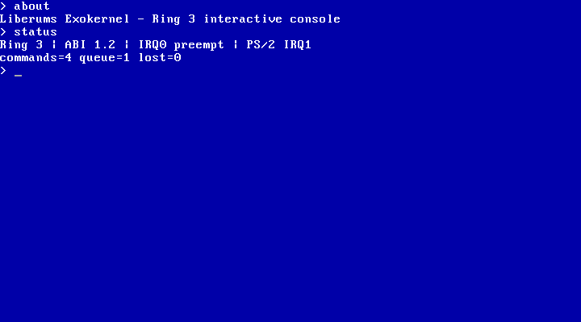

# Phase 7.2：PS/2 输入与 Ring 3 交互 Console

本阶段接着 Phase 7.1 的 VGA 授权映射开发，保留 Phase 1～7.1、COM1、默认 headless 启动
及 ABI 1.2。用户已在 WSL2 + QEMU GTK 实际确认 Phase 7.1 显示正常；
本次云端自动化证明键盘输入链路，**新的本地实体键盘交互仍需用户确认**。

## 运行与范围

```sh
export PATH=/workspace/.liberums-tools/bin:$PATH  # 仅本云环境
make -j2
make run                         # 原串口/headless 路径不变
make run-vga                     # 原 Phase 7.1 显示实验不变
make run-console                 # 新交互 Console，默认 QEMU_DISPLAY=gtk
make run-console QEMU_DISPLAY=none
make debug QEMU_APPEND=interactive-console
make test-keyboard               # native 队列/授权 + QMP/GDB 真实输入
make test                        # Phase 1～7.2 完整回归
```

在本地 GTK 窗口中点击 QEMU 显示区后输入；命令区不读取宿主终端或 COM1。
支持 US 字符键、Shift/Caps Lock、Backspace、Enter 与硬件文本光标。
`help` 列出 `help clear about status`，`clear` 清屏，`about` 描述系统，`status`
显示当前 profile、已处理命令数、队列长度和本次键盘 handle 的丢失字节数。
命令区分大小写，输入上限 63 字符；行首 Backspace 不越过提示符，超长输入不越界。
屏幕满时滚动由 Ring 3 完成。

这是小型命令 Console，不是完整 Shell：没有进程启动、文件系统、GUI、鼠标、网络、
命令历史、光标左右编辑、完整键盘布局/Unicode 或热插拔输入框架。
不修改 Aelthuvor，不开始后续阶段。没有新增外部 ELF profile；Console 仍是独立编译的内置用户映像。
当前用非阻塞 POLL + YIELD 等待输入，没有节能 idle 或通用阻塞 I/O。
启动实验同时运行一个不合作 peer，用于持续验证 IRQ0 调度与授权隔离。

## 1. 从物理事件到显示

```text
QEMU GTK 键盘 / QMP input-send-event
  -> QEMU PS/2 keyboard -> i8042 output buffer
  -> PIC master IRQ1 -> IDT vector 33 / DPL0
  -> keyboard_irq_entry 保存现场、切 kernel selectors、CLD
  -> keyboard_dispatch 有界读扫描码、入授权队列、一次 master EOI
  -> IRET 恢复原域
  -> SYS_KBD_POLL 验证 handle/owner/epoch
  -> Ring 3 set-1 keymap / 编辑 / 命令 / VGA 文本写入 / 光标选择
```

内核不将扫描码转换成字符，不处理命令、不编辑输入、不把串口当键盘。
IRQ1 不调度域；原 IRQ0 继续按 PIT tick 抢占，包括打断不执行 YIELD 的 peer。

## 2. 最小 i8042 初始化

`arch/x86/ps2.c` 只支持当前 QEMU i686 `pc` 的第一 PS/2 端口。
在 IF=0、PIC IRQ1 已屏蔽时禁用端口、清理旧输出、读取 controller config，
设置第一端口 IRQ、translation，禁用 AUX/IRQ12，然后让键盘选择 set 2、启用扫描。
控制器将 set 2 翻译成用户约定的 set 1。每条键盘命令检查真实 `0xfa` ACK；
不是通过假设 SeaBIOS 留下的状态来声明扫描格式。

输入缓冲等待/响应各最多 100000 次状态轮询，启动 drain 最多 256 字节；
这是循环次数界限，不是精确的墙钟超时。失败明确拒绝启动，不能无限等待缺失的控制器。
不做通用 controller/USB 枚举、mouse 协议或任意用户端口操作。

IRQ 路径不做这类长轮询，每次至多读取 32 个可用字节。
AUX、parity/timeout 和设备 overrun/error 字节不会当字符交付；
已授权输入发生这类丢失时，也走有界 overflow 通知以让用户复位解码状态。

## 3. IRQ1 与 IRQ0 的边界

`keyboard_irq_entry` 是独立汇编入口，保持原 timer entry 不变。
在使用 AX 前 PUSHAL 保存全部 GP 寄存器，再保存 DS/ES/FS/GS；
内核 C 使用可信段寄存器、DF=0 和对齐栈，返回时恢复原段、寄存器与完整 IRET frame。
Ring 3 入口通过已有 TSS 取得每域可信内核栈。

vector 33 是 DPL0 interrupt gate；用户 `int $0x21` 产生 #GP，不能伪装硬件 IRQ。
`keyboard_dispatch` 不切 CR3，不做调度或在中断栈上回收地址空间。
无论空 IRQ、丢弃或成功入队，都对 master PIC 发送一次 EOI，不对 slave 发送 EOI。

PIC 初始 remap 仍由原 `timer_start()` 完成，键盘不重新初始化 PIC/PIT。
IRQ1 mask 只修改 master IMR bit 1，保留 IRQ0 bit 0：交互期间通常为 `0xfc`，
键盘撤除后为 `0xfe`。交互 profile 显式启用 timer，用户 IF=1；
默认合作 profile 和原 ABI features=31 / preempt features=119 保持不变。

## 4. 有界队列与权限

`kernel/keyboard.c` 使用固定 64 字节 FIFO，没有用户可写队列或共享内核地址。
单 CPU、interrupt gate 的 IF=0 保证 IRQ producer 与 syscall consumer 不并发；
不依赖用户提供锁，也没有对用户指针的解引用。

可信启动器先给域 1 一个 exclusive grant，绑定 domain ID 和 epoch。
ACQUIRE 返回独立 namespace 的 index=`0x00010002` 与完整 generation。
复用已有 `capability_check()` 验证 ID/epoch/generation/READ 权限，generation 耗尽永久失败，不能回绕。
知道真实活动 handle 的 peer 仍不能 POLL、STATS、RELEASE 或重新 ACQUIRE。
没有原始端口、队列地址、转移授权或向其他域投递任意输入的公开 API。

无活动 owner 时丢弃输入；ACQUIRE、RELEASE 和 revoke 清除全部队列字节。
丢失计数在新 acquisition 重置，避免向新 owner 暴露旧接收者的输入统计。
旧 handle、旧 epoch 和域退出后的权限均失效。

### 溢出约定

满队列后保留现有 FIFO，后续字节丢弃并饱和计数，不覆盖未消费项。
下一次 POLL **先返回 EOVERFLOW 并丢弃整个不完整批次**，EDX 包含被丢弃的所有字节数，
包括旧队列项；随后恢复空队列。错误、丢失和 IRQ 诊断计数都不回绕。
这样不会把“Shift make 已收到、break 已丢失”的残缺批次继续作为完整序列解释。
Ring 3 在 overflow 通知后清除 modifier/prefix 状态及当前输入行，并显示复位提示。

计数单位是扫描码字节，不是字符或按键数；一次按键可能产生 make/break 或多字节 prefix。
复位不重建实体键盘所有按下状态：若丢失时还按着 Shift 等键，应松开后重新按下。

### ABI 1.2 可选扩展

旧调用号、version 和 feature/profile 不变。旧内核对新调用返回 ENOSYS；
新程序用 INFO 探测可用性。错误输出 EDX 为零，唯独 POLL 的 EOVERFLOW 返回丢弃数。

| 调用 | 输入 | 返回 |
|---|---|---|
| KBD_INFO=40 | EBX=device 1 | EAX=64，EDX=translated set 1；未启用则 ENOENT |
| KBD_ACQUIRE=41 | EBX=device 1 | EAX=index，EDX=generation；须有可信 grant |
| KBD_POLL=42 | EBX=index，ECX=generation | EAX=0、EDX=raw byte；空则 EAGAIN；丢失则 EOVERFLOW |
| KBD_RELEASE=43 | 同上 | EAX=0；清队列并使 handle 失效 |
| KBD_STATS=44 | 同上 | EAX=queued bytes，EDX=本 handle lifetime lost bytes |
| VGA_CURSOR=36 | VGA index/generation，EDX=cell | 验证可写且已映射，cell<2000，然后更新 CRTC 光标 |

光标的位置选择在 Ring 3；内核只检查已有 VGA capability、范围并执行固定 CRTC 操作，
保留 firmware shape，读回硬件位置确认写入成功，不向用户开放端口号/寄存器号。

## 5. 用户态策略与清理

`user/interactive_console.c` 包含 US set-1 keymap、左右 Shift/Caps 状态、make/break 处理、
E0/E1 跳过、输入行、颜色、文本滚动、命令比较与处理、光标位置选择。
这些结构放在本域私有 data page。光标通过受限 VGA 调用更新，文本仍通过原 MMIO 页写入。

调度器在 EXITED、FAULTED 和计数耗尽终止路径调用 `keyboard_revoke()`：
先屏蔽 IRQ1、失效授权、清零队列，再有界禁用第一 PS/2 端口并丢弃残留输出。
不停止 IRQ0；随后保留原 VGA 与 RAM 清理。第二轮启动重新初始化端口，不能继承上轮事件或 handle。
VGA 屏幕内容和最后光标位置可保留，设备页仍不进入 RAM 的 zero/free/transfer 流程。

`tests/phase72_runtime.c` 仅为显式 `interactive-console` 启动路径授予设备，
`console-test` 才运行两轮生命周期；默认无自动退出命令。
测试控制字段只位于测试程序自己的用户 data page，用于请求真实 EXIT/#GP/撤销或解除消费暂停。
它们不生成扫描码、不写内核队列；所有被识别成输入的字节都必须来自 PS/2 IRQ1。

## 6. 实际验收

[验收记录、源码 hash 和截图](phase72-evidence/README.md)保存于仓库。

- 修改前 Phase 1～7.1 基准通过；完成后 `make test` 保留原断言并通过，包含新键盘 suite。
- Native ASan/UBSan 使用实际 queue/authority 源码，仅 mock 硬件，检查 FIFO/wrap、32 字节 drain 上限、
  overflow/reset/saturation、owner/epoch/namespace、release/revoke、generation exhaustion、IRQ0 mask。
- 独立 Ring 0 诊断通过 QMP 注入、真实 IRQ1/EOI，验证 unowned 输入不进入队列。
- 8 个 Ring 3 guest，各执行两轮：functional、in60、out64、INT 0x21、#UD cleanup、
  revoke、release/reacquire、真实 overflow。每个 guest 都有一个未授权、不合作 peer。
- functional 检查实际 make/break、Shift/Caps、E0 忽略、回显、行首/超长 Backspace、63 字符界限、
  Enter、help/clear/about/status、实际 VGA 字节与光标选择。
- IRQ1 每次 entry/IRET 前检查 GP、段、ESP、CR3 和 CPU frame；peer 的 GP sentinels 和 CF/DF
  以及其 IRQ0 preemption 计数同时被检查，防止键盘中断破坏抢占与恢复。
- 实际 `in 0x60`、`out 0x64` 和 `int 0x21` 在 CPL3 触发正确 #GP；
  queue、grant、handle、VGA binding、页表与 free count 在每轮退出/异常后检查。
- QMP `info pic` 检查 IRQ1 ISR 清除和 IMR=`fe`，QMP screendump 取得实际 VGA 渲染图像。
- `make run-console QEMU_DISPLAY=none` 实际执行并确认完成硬件/授权启动。
- 未修改历史 Aelthuvor ELF 的独立兼容性 suite 再运行 15 guests / 30 lifecycles；
  旧 ELF 和 SDK hash 校验保留，不声称旧 `test-libos` 字节漂移入口已被修复。

复验曾发现 GDB/TCG 在单步跨越其他断点、恰好发生中断入口时，可能重复报告 IRQ 第一条指令：
一次记录为 165 次入口断点、164 次真实 dispatch/EOI/返回。验收点现移到第一条 PUSH 后、
修改 GP 寄存器前，按固定栈偏移读取原 CPU frame，并把每次捕获/返回与实际 IRQ/EOI 计数对应；
没有删除现场或计数断言。修正后额外连续执行 4 次 overflow guest（8 轮）及完整回归。
诊断失败记录与最终通过记录分开保留。

测试不会往串口写入键盘数据。注入器只在 QEMU 的 query-status 确认 running 后使用
`input-send-event`，避免 debug-stop 时 UI 注入被忽略；GDB 检查每个实际交付字节。
有些旧批次同时由一次 IRQ drain 读入，因此 IRQ 数不应简单等于扫描码字节数。

本云 QEMU 只有 `none` 显示后端。自动化证据分别是 IRQ/授权、VGA 显存及 QEMU 渲染截图，
不代表本地 GTK 的焦点、实体键盘布局、长按/窗口交互已验证。
本地请运行 `make run-console`，点击窗口依次试输入 `help`、修正拼写、`clear`、`about`、`status`。



## 阅读顺序与参考

先看 `arch/x86/ps2.c` 的状态/ACK，再看 `keyboard_irq.S` 的异步现场，
然后阅读 `kernel/keyboard.c` 的队列与授权，最后看用户态 `interactive_console.c` 的策略。
原 VGA 映射边界见 [Phase 7.1](phase7-vga-console.md)。

参考：[QEMU input-send-event / QMP](https://www.qemu.org/docs/master/interop/qemu-qmp-ref.html#module-ui)，
[Intel SDM](https://www.intel.com/content/www/us/en/developer/articles/technical/intel-sdm.html) 的 I/O privilege、IDT/TSS/IRET，
[PS/2 controller](https://wiki.osdev.org/I%228042%22_PS/2_Controller) 与
[PS/2 keyboard scan sets](https://wiki.osdev.org/PS/2_Keyboard) 的协议说明。
