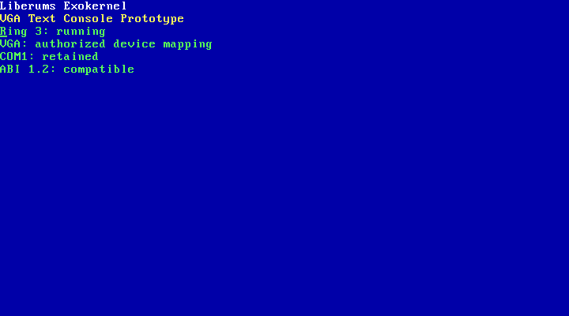

# Phase 7.1：VGA Device Mapping 与用户态 Console

本阶段沿用 Phase 1～6 的 Multiboot、GDT/TSS、域、RAM capabilities、分页、
外部 ELF32 和调度器，只增加 legacy VGA 所需的最小设备绑定。
**内核仲裁显示页访问；Ring 3 决定字符、颜色、清屏、换行和布局。**
不修改 Aelthuvor，不实现完整 Phase 7、GUI、Shell、输入驱动、文件系统、网络或通用设备框架。

## 1. 先证明显示路径

目标为 QEMU `pc` / i686、单 CPU、TCG、SeaBIOS 的 80×25 mode 3 文本模式。
原 Multiboot flags=3 不请求图形模式，也不通过 BIOS 调用主动设置显示模式。
`vga_probe()` 在分页前读取 BDA 的 mode/columns/rows/page offset，并检查 VGA graphics
controller 的 text/地址窗口位和 CRTC start address。它只选择寄存器后读取并恢复索引，不重设显示模式。
不满足 mode 3、80×25、page zero 等条件时启动明确失败，不把任意 framebuffer 当文本页。
分页会去掉 page zero，因此不能在分页后通过 `0x449` 等地址读取 BDA；探测结果保存在可信内存。

`make run-vga-diag` 只运行 Ring 0 诊断：通过 supervisor MMIO alias 写入
`Liberums Ring 0 VGA diagnostic` 与颜色，随后停止。这不是正式 Console，也不会在 `make run-vga`
中调用。GDB 检查实际 VGA 字节、属性及 PTE，而不是相信串口中的成功提示。

## 2. 设备页与普通 RAM 的区别

mode 3 每个 cell 两字节：低字节为字符，高字节为属性（低四位前景色，高四位背景/闪烁属性）。
80×25×2=4000 字节，从物理 `0x000b8000` 开始。

x86 非 PAE 页粒度为 4096 字节，本阶段授权的设备范围是
`[0xb8000, 0xb9000)`；最后 96 字节是同一 VGA aperture 内的填充，不是普通 RAM。
**不声称 MMU 能隔离这 96 字节。** 前后相邻设备页均不向用户映射。

原 `physical_pages_init()` 已永久保留低 1 MiB，无需重写分配器。
VGA 页保持 `PAGE_RESERVED`，`SYS_PAGE_SPECIFIC(PFN=0xb8)` 被拒绝；普通申请不会分配它。
VGA 不进入 `resources[]`、域 RAM 配额、普通清零、free、transfer 或 Phase 6 RAM 撤销事件路径。
设备释放保留屏幕内容，这是当前显式设备语义，不提供跨 owner 的显示内容保密保证。

## 3. 可信授权与 secure binding

`vga_device_grant()` 是内核内部的可信启动授权入口，绑定 domain ID、epoch 和 READ/WRITE 上限。
当前仅显式 `vga-console` 启动实验会把 grant 给测试域 1；其他域和普通外部 ELF 不自动获得设备权限。
用户不能通过声称某个域 ID、传入物理地址或知道句柄数值来获得授权。
这项最小启动仲裁不负责 Console 的输出策略；未来启动器/用户态显示驱动的选择仍需单独设计。

一个 VGA 设备仅允许一个 exclusive grant、一个活动 handle、一个 binding。
设备句柄 index=`0x00010001`，与 RAM 的 1～16 分开，完整 32 位 generation 不回绕，
耗尽后返回 `RES_EOVERFLOW`。验证复用原 `capability_check()` 的 owner ID/epoch/generation/rights。
只读 grant 或 handle 不能提升为可写，release 后旧 handle 立即失效，重新 acquire 使用新代数。
新域 epoch 不继承旧 grant。没有设备转移接口。

`address_space_vga_bind()` 不接收任意 PA，只接受可信空间和 writable 布尔值。
唯一用户 VA 是 `0x09400000`，位于独立 PDE；其私有 RAM 页表只存在一项 VGA PTE。
用户不能选择 kernel VA、页表地址、长度、缓存标志、额外别名或其他设备。
PDE 为 P/RW/US=7；PTE 为 `0xb801d`（只读）或 `0xb801f`（可写），
CPU 运行后可另加 A/D 位。所有 kernel PDE 仍是 supervisor，页表 RAM 也只有 supervisor alias。
普通 32 位分页没有 NX，因此这里不承诺设备页不可执行或完整 W^X。

### 缓存与生命周期

VGA 的 supervisor alias PTE 为 `0xb801b`；用户 alias 的 PCD/PWT 位也都为 1，PAT bit 为 0。
如果 CPU 支持 PAT，启动探测读取 IA32_PAT 并要求 PAT[3]=UC；无 PAT 时使用 legacy PCD/PWT UC。
不修改 PAT/MTRR，不把互相冲突的 WB/UC alias 暴露给用户。

绑定分配失败时不发布记录；实际耗尽 RAM 的测试验证 `RES_ENOMEM`、PDE 不变与页表无泄漏。
release 在当前 CR3 下删除 PTE/PDE、重载 CR3 刷新 TLB，再清零并释放**页表 RAM**。
可信 `vga_device_revoke()` 同时撤除 grant；旧 handle 失效且无法重新 acquire。
调度器在域退出、异常和计数耗尽终止时执行此清理，再进入既有 RAM cleanup。
非活动空间不能执行，下一次激活的 CR3 reload 会排除旧 TLB 翻译。
`address_space_destroy()` 拒绝带着设备页表销毁空间。

这不是 Phase 6 的带 deadline/ACK 的通用设备撤销协议，也不支持 DMA；仅为单 CPU VGA 页同步撤除。
用户不能执行 `in/out`，原 TSS I/O bitmap 和 IOPL 保护保持生效。

## 4. 兼容的标量扩展

新增公共头 `include/abi/vga.h`，保留 ABI version **1.2**、原有 feature/profile 数值及调用语义。
这是可探测的可选调用号扩展；旧内核对新号返回 ENOSYS，不应仅凭 minor=2 假设支持 VGA。
新程序先用 `SYS_VGA_INFO` 探测；INFO 返回几何信息也不代表有授权。
普通启动未启用此硬件 profile 时 INFO 返回 ENOENT。
外部 ELF note/loader 不变，当前 Console 是独立编译后嵌入的用户测试映像，而不是内核链接的渲染函数。

| 调用 | 输入 | 成功输出 |
|---|---|---|
| INFO=32 | EBX=device 1 | EAX=80 \| (25<<16)，EDX=4096 |
| ACQUIRE=33 | EBX=device 1，ECX=READ 或 READ\|WRITE | EAX=index，EDX=generation |
| MAP=34 | EBX=index，ECX=generation，EDX=固定 VA，ESI=READ[\|WRITE] | EAX=0 |
| RELEASE=35 | EBX=index，ECX=generation | EAX=0，撤除映射及 handle |

错误返回负 RES_*；INFO/ACQUIRE 的错误 EDX 为零。没有用户指针传入内核。

## 5. 用户态 Console 与启动

`user/vga_console.c` 在真实 Ring 3 执行，只通过 ABI 申请授权映射，然后直接写用户 VA。
其 `clear()` 和 `text()` 实现清屏、换行与颜色，依次绘制：

```text
Liberums Exokernel
VGA Text Console Prototype
Ring 3: running
VGA: authorized device mapping
COM1: retained
ABI 1.2: compatible
```

状态文字描述当前实验，不是动态系统监视器。程序退出后映射被撤除，VGA 内容仍可见。
测试 peer 使用盗取的真实活动 handle 尝试映射、释放及实际写入；它的预期 #PF 不妨碍 Console。
`tests/phase71_runtime.c` 仅在显式 boot option 中构造这些实验；默认 Phase 1～6 路径不变。

```sh
export PATH=/workspace/.liberums-tools/bin:$PATH  # 此云环境工具路径
make -j2
make run                       # 保持原 headless 串口路径
make run-vga-diag               # 仅 Ring 0 诊断；默认 GTK
make run-vga                    # 真正 Ring 3 Console；默认 GTK
make run-vga QEMU_DISPLAY=none  # 无窗口、COM1 输出；截图由测试生成
make debug QEMU_APPEND=vga-console
make test-vga                   # native + Ring 0 + Ring 3/GDB + QMP 截图
make test                       # 原 Phase 1～6 + 新 VGA native/硬件/截图
```

本地 WSLg 需要支持 GTK 的 QEMU、正常的 DISPLAY/Wayland 和 WSLg 会话。
在仓库根目录运行 `make run-vga` 可请求独立窗口；若后端不可用，QEMU 会报错，
不会静默把串口成功当图形成功。也可覆盖 `QEMU_DISPLAY` 使用本机支持的后端。
本云环境 `qemu-system-i386 -display help` **仅列出 none**，没有实际运行 GTK/WSLg 窗口；
本地窗口可见性仍需用户验证，不宣称已经验证。

## 6. 自动化验收与证据

2026-11-16，Liberums2 恢复环境：GCC 14.2.0、Binutils 2.44、QEMU 10.0.13、GDB 16.3。
修改前原 `make test` 成功；完成后完整回归保留所有原测试，未删除或弱化其断言。
记录在 [phase7-evidence](phase7-evidence/README.md)。

三种证据严格分开：

1. COM1：启动信息及实验完成，保留原诊断；串口不是显卡证明。
2. 显存/MMU/执行：GDB hardware breakpoints 检查 Ring 3 CS=0x1b、SS=0x23、域 CR3、
   真正的页表、4000 字节字符/属性、只读读取、异常 vector/error/CR2、两轮回收及 free count。
3. QEMU 渲染：`display none` 下 QMP `screendump` 生成实际 VGA 渲染器的 PPM/PNG。
   测试验证 720×400、三行不同前景色与清空后的蓝色背景；这是像素证据，仍不等于 GTK 窗口验证。



`make test-vga` 包含：native authority 边界（grant 权限缩减、owner epoch、命名空间、exclusive、
无效地址、OOM 回滚、stale handle、重复撤销、代数耗尽）、独立 Ring 0 诊断、
11 个用户 guest（每个两轮）、单独截图 guest，以及两个真实 Makefile 入口的功能启动。
用户场景：normal、可信 revoke、上界、原始 PA、readonly 写、kernel 写、端口 I/O、页表写、
release 后访问、下界、真实 RAM 耗尽后的绑定回滚与重试。每个用户 guest 都额外运行无授权 peer。
正常退出、带映射异常退出和主动/强制撤除均有实际 PTE/清理检查。
页表计数恢复与 VGA 保留状态一起检查，防止把设备页当 RAM 回收。

兼容性可独立复验：

```sh
# 使用已构建、源码未修改的固定历史 Aelthuvor checkout：
make test-vga-compat AELTHUVOR=/path/to/reviewed/Aelthuvor
```

本次从 Aelthuvor `b10d337d254b18e98204990203a77a215c82c568` 的未修改源码构建既有变体，
保留其 pinned ABI 1.1 SDK 的 hash/source 校验。新 `phase71_compat.py` 复用原集成断言，
仅像既有独立审查一样将“运行内核必须恰为 1.1”的历史 oracle 改为 1.2。
15 guests / 30 lifecycles 验证 First-fit/Best-fit、原错误与回收路径、敌对 peer，
以及旧合作 ELF 在 preempt profile 下仍被拒绝。测试前后 ELF hash 与 Aelthuvor tracked status 不变。
**未修复或宣称旧 `make test-libos` 的 SDK 字节漂移检查通过**，其原有限制见历史审查。

阶段到此停止；不提供键盘、滚屏、Shell、动态驱动授权服务、外部 VGA Console ELF profile、
DMA 隔离或跨域设备委托。

## 7. 对照源码阅读

- `kernel/vga.c`：分页前硬件探测、PAT 类型检查与独立 Ring 0 诊断。
- `kernel/vga_device.c`：独占 grant、handle、权限与 revoke 状态机。
- `arch/x86/paging.c`：固定用户 MMIO PTE 与 TLB/页表 RAM 生命周期。
- `kernel/syscall.c` / `include/abi/vga.h`：标量边界，不传任意物理地址或用户指针。
- `user/vga_console.c`：用户态字符与属性字节写入、clear/newline/layout。
- `tests/phase71.py`：GDB 从真实 CPU/页表/显存读证据；QMP 从显示模型取像素。

参考：[QEMU QMP display/screendump](https://www.qemu.org/docs/master/interop/qemu-qmp-ref.html#module-ui)，
[Intel SDM](https://www.intel.com/content/www/us/en/developer/articles/technical/intel-sdm.html) 的分页、PAT、TLB 与权限规则。
