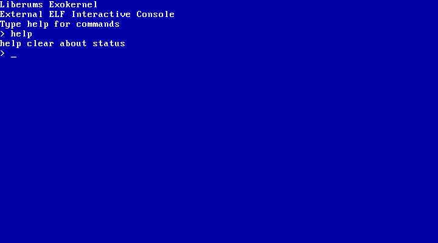
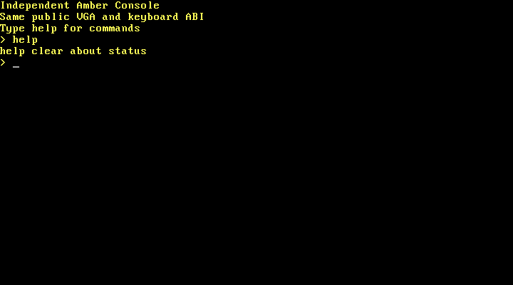

# 独立 ELF32 Console：构建、替换与运行

## 本地 WSL2 + QEMU GTK

在最新 Liberums 仓库根目录执行，已安装 GCC/Make/Binutils/QEMU 的前提下：

```sh
git pull --ff-only
make -j2
make external-console
make run-external-console
```

点击 QEMU 图形窗口，输入 `help`、`about`、`status`、`clear`；测试拼写修正、
行首 Backspace、Shift/Caps Lock、Enter 和滚动。支持 US set-1 字符解释、63 字符输入上限。
本阶段保留四个命令，不提供任意程序运行型 Shell。

替换程序无需修改内核或系统调用：

```sh
make run-external-console CONSOLE_ELF=build/external/amber.elf
make run-external-console CONSOLE_ELF=build/external/console.elf QEMU_DISPLAY=none
make debug QEMU_APPEND=external-console QEMU_INITRD=build/external/console.elf
```

`QEMU_DISPLAY` 默认 `gtk`；云端只有 `none`，通过 QMP 键盘注入及截图验证。
用户已确认 Phase 7.1 本地 VGA 窗口；新的外部交互程序仍需本地实际确认。

## 构建边界

`make -j2` 构建内核及旧内置实验。`make external-console` 只递归调用独立用户 Makefile，
不链接内核目标文件；公开 SDK 根目录由 `SDK` 指定。

```sh
make -C user/external_console SDK="$(pwd)/include" OUT="$(pwd)/build/my-console"
make run-external-console CONSOLE_ELF=build/my-console/console.elf
```

`run-external-console` 使用已经构建的 `build/liberums.elf`，不隐式重建内核；
内核文件缺失会拒绝启动。修改内核后须明确先执行 `make -j2`。
这样，即使修改共享用户态绘制/编辑代码，也能只重建外部 ELF、运行既有内核。
若还希望旧内置 Console 同步采用共享代码的改动，再显式重建其内核映像。

内核的 `user_images.S` 只嵌入旧实验，不嵌入 `build/external/console.elf`。
专项测试复制用户源码及仅含 `include/abi/` 的 SDK，修改入口欢迎文字和共享 editor 的 help 输出，
重新构建并实际运行，核对内核 SHA 和 mtime 不变、显存确实显示修改后的文字。
这与只改文件名或重新链接相同内核不同。

## ELF 与状态

- `main.c` 的 `_start` 是普通 freestanding C 入口，使用公开的 ABI note。
- `core.c` 接收指向用户态 `struct console` 的指针，不假定数据页固定 VA。
- 欢迎文字在 R/O 段，style 为普通初始化 data，Console 状态和观察记录在 BSS。
- 独立 linker script 产生 RX/R/RW PT_LOAD 与唯一 PT_NOTE，遵守既有公开 ELF profile。
- 用户栈仍由原 loader 在 `[0x083fc000,0x08400000)` 私有构造；没有新 loader 或动态链接。
- VGA 的固定用户 VA 是设备 ABI 的受控 binding，不是对内置程序数据布局的依赖。

`layout.elf` 是专项 loader fixture，实际运行跨页 RX/R/O/data/BSS，验证文件复制、BSS 零值、
边界访问和第二代码页。无需把无用的大数组塞入正常 Console。

## 持续运行与观察

普通外部程序本来就能在用户态循环并被 IRQ0 抢占，新的 Console 只复用这一能力。
调度器不解释输入，不安排应用级任务，不因为 ELF 的名字更改退出语义。

用户态 no-op 观察点供 GDB 检查实际执行，不提供权限、不修改内核队列，正常程序无需调试器。
`console-test.elf` 才含测试专用私有请求变量，用于真实 EXIT/#UD 或等待可信撤销；
生产 `console.elf` / `amber.elf` 没有这些控制分支。




