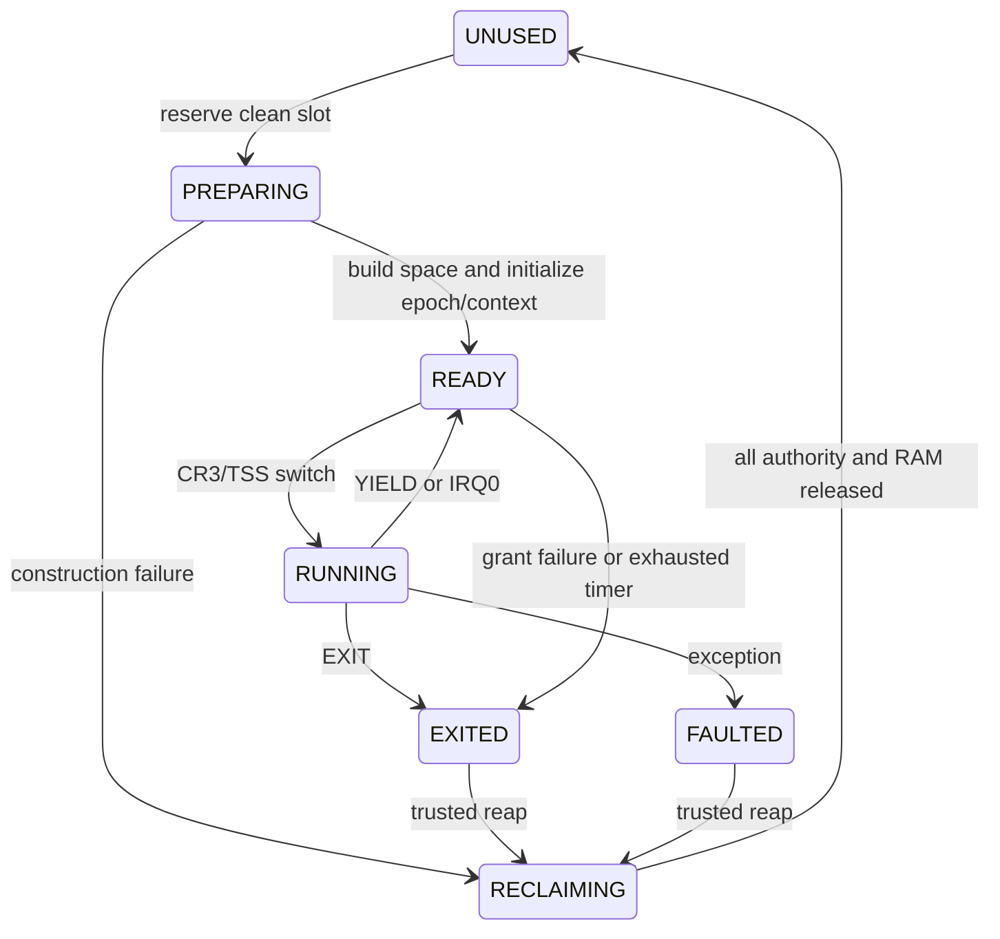

# Phase 8：槽位与域生命周期

`domain_slot(id)` 只供可信内核代码使用；ID 1～4 对应数组下标 0～3。
`domain_lookup(id)` 仅返回 READY/RUNNING 域，PREPARING、终止及回收对象不能成为资源转移目标。
用户不能读取或改写这些对象，公开 ABI 没有创建或销毁域的系统调用。



旧状态数值 0～4 保留以兼容历史调试器；PREPARING=5、RECLAIMING=6 追加。
`pool_owned` 区分新动态生命周期与旧启动者；旧 profile 的终止域仍可供历史测试观察，
由旧启动者销毁地址空间，不自动改成 UNUSED。

## 创建事务

1. 先使用原有 ELF parser 按当前 ABI features 完整校验该映像，失败不触碰槽位。
2. 查找 UNUSED 且无空间、绑定、资源、inbox、设备 grant 或撤销事件的槽位。
   脏 UNUSED 不能被当成合法空闲对象；活动域和非空状态始终跳过。
3. 标记 PREPARING，构造独立地址空间。每个分配页立即进入原回滚列表。
4. `domain_initialize` 推进 Epoch，初始化上下文、段、计数与独立用户栈入口，标记 READY。
5. 应用显式设备 grant；失败将终止本次对象并 reap，不能撤销其他拥有者的设备。
6. 全部成功才向可信调用者返回 domain 指针。单 CPU、IF=0 下调度器不会观察到半成品。

物理 OOM、槽位 ENOSPC、ELF ENOEXEC、ABI EPROTONOSUPPORT 和 grant 冲突分别报告。
失败后继续检查下一个模块；已经成功的域和其地址空间保持有效。
终止槽位不会在没有 reap 的情况下直接重用。达到 `UINT32_MAX` 的 Epoch 永不回绕；
该槽位退休，若无其他可用槽位则安全返回 EOVERFLOW。
还未建立身份的 PREPARING OOM 不消耗 Epoch；已经初始化后 grant 失败会消耗一次 Epoch。

## 回收顺序

调度返回可信启动栈、IF=0、内核 CR3、`current_domain=NULL` 后，先执行终止清理：
Keyboard 停止/屏蔽 IRQ1、清队列及授权；VGA 撤销用户映射及授权；普通资源移除全部别名、
取消撤销请求、清 inbox、清零并归还 RAM。
动态启动者随后执行 reap：标记 RECLAIMING，幂等重做清理并确认无授权，
销毁独立映像/用户栈/页表，清寄存器、段现场和 8192 字节内核栈，最后发布 UNUSED。
VGA 设备页不清零、不释放、不进入普通 RAM 资源流。

ID/Epoch 和最后终止状态/计数暂留供诊断；下一次 initialize 清除本次执行计数。
`last_state` 只供调试，绝不作为授权判断。
不能 reap 当前运行域，不能销毁当前 CR3，不能 reap READY/RUNNING 域。

## 最小可信 C 示例

```c
struct domain *domain = NULL;
int32_t error = domain_create_external(image, image_length, 0, &domain);
if (error == 0) {
    /* 调用者已完成 GDT/PIT 初始化，位于内核栈，IF=0。
     * 0 表示不授予任何设备。调度所有 READY 域，终止后返回。 */
    domain_schedule();
    error = domain_reap(domain);
}
/* 每个 error 都必须处理；失败返回的 domain 为 NULL。
 * 这段是可信启动者示例，不是可以从 Ring 3 调用的 API。 */
```

当前普通 multi 启动者先加载最多四域，运行至全部终止再 reap。
“其他三域继续运行时复用槽位”的实际验收通过 `selftest=phase8` 的可信诊断钩子调用同一 API。
该钩子不是用户态进程服务，用户不能写其控制对象；正常启动不执行诊断请求。
