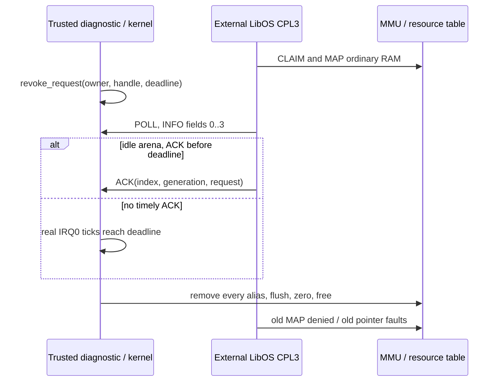

# Phase 9：外部 LibOS 普通 RAM 撤销

设备 revoke、native Mock 或串口消息都不能替代本页的普通 RAM E2E。
测试消费者 `tests/fixtures/security9/ael_ram.c` 使用独立导出的 Application SDK：
context 不透明，只调用公开 alloc/free/check。运行的 allocator、runtime、POLL/INFO/ACK 实现来自未修改的 Aelthuvor。
同机还有 Independent Reference（自己的 CRT/runtime/wrapper/固定对象池）及两个不可信 worker。

## 可信触发

`tests/phase9_runtime.c` 只在 boot 显式 `selftest=phase9` 时启用。
GDB 向 supervisor mailbox 提交 ID、期望 Epoch、handle、delay；在来源域安全返回调度器后，
检查 ID/Epoch 并调用原 `revoke_request(..., PRESSURE)`。没有用户撤销 syscall、应用名称或私有结构解析。
提交成功/失败均消费一次；输出 request/deadline 只作观察，不授予权限。
默认关闭、缺失域、旧 Epoch、他域/旧 handle、零 delay 都有真实测试。
测试结束要求 submit=0、事件表 inactive；留存的只读诊断结果不是活跃授权。

## 主动 ACK

App 先分配并写入实际页，再通过公开 free 释放对象而不 trim，留下合法拥有的空闲 arena。
请求随后到达，未修改的 `ael_app_check` 经真实 POLL、四个 INFO 和 ACK 处理该空闲页。
GDB 在 syscall trap 捕获实际参数，并核对 owner Epoch、请求、Generation、deadline。
ACK 后所有 PTE 消失、资源 FREE、1024 个物理字为零；同一 PFN 再 CLAIM/MAP 时仍全零，旧 MAP/ACK 拒绝。

这里不是让活跃对象在撤销后迁移。Ael SDK 若在仍有活跃对象时看到请求，会安全退出 96；
测试明确验证这个行为，不修改 LibOS 私有元数据来强迫 ACK。

## 超时与交错

对活跃页建立两个合法用户别名，发起短 deadline，用户不 ACK。
真实 PIT 到期经过原 revoke_expire/reclaim；GDB 检查两个 PTE、PDE/table、引用计数、页状态和全部字节。
随后旧句柄 MAP 返回 ESTALE；独立再申请同 PFN 验证清零。
继续调用 SDK check 时安全退出 96；另一场景执行精确标记的旧指针 load，触发真实 #PF(error=4)。
Independent Reference 和其他 worker 都须完成其自身校验并退出 0。

还覆盖请求后 EXIT、请求后 #UD、RELEASE 取消、迟到/重复 ACK、旧 Request/Generation、
ID/Epoch 复用、八个事件耗尽与拒绝额外事件。
`tests/revoke_tests.c` 用真实资源/撤销代码与模拟时钟检查 deadline−1 ACK 成功、deadline ACK 强制完成且返回 ESTALE；
该精确整数边界属于 native 测试，不能冒充连续硬件时间实验。

强制撤销没有透明恢复协议，失效地址不能继续安全解引用；安全失败和硬件 #PF 是明确验收结果。
